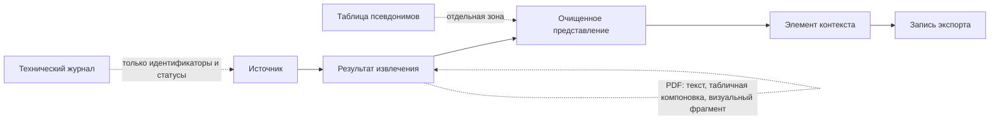

# Модель хранения и происхождения Gaia

Модель применяется только к новым контролируемо принятым материалам. Она не мигрирует и не меняет существующие рабочие пространства.

## Зоны

Локальный каталог `storage` содержит семь изолированных зон: `sources`, `artifacts`, `sanitized`, `context`, `pseudonyms`, `exports` и `metadata`. В Git он исключён. Источники и производные тексты хранятся отдельно от реестра метаданных; псевдонимы — отдельно от очищенных представлений.

## Объекты и идентификаторы

Для новых объектов используются случайные непрозрачные идентификаторы: рабочего пространства, источника, производного результата, элемента контекста и экспорта. Контрольная сумма — отдельное поле целостности и не является публичным идентификатором.

Каждая запись содержит рабочее пространство, время создания, статус, версию схемы, родителей, версию обработчика и при необходимости версию правил. Очищенные представления и производные результаты получают новую версию вместо перезаписи; предыдущая помечается заменённой.

Для PDF управляемый результат извлечения может содержать несколько фрагментов материала: нативный текст страницы, её табличную компоновку и встроенный визуальный фрагмент. Каждый фрагмент хранит modality, страницу, локатор и origin; само производное содержимое и изображение остаются только в закрытой зоне `artifacts`. Visual OCR — наблюдение, а не доменный факт: если OCR недоступен или не подтвердил текст, визуальный фрагмент получает partial status, но доступные текст и таблицы сохраняются. Это не создаёт новый knowledge-layer и не заменяет существующие review/current gates.

## Приём и повторная обработка

Приём вычисляет контрольную сумму и ищет повтор только в текущем рабочем пространстве. Повтор возвращает существующий источник без второй копии. То же содержимое в другом пространстве создаёт независимый источник. При несовпадении контрольной суммы источник помечается требующим повторного приёма.

Запись сначала создаётся локально, затем атомарно регистрируется. Если реестр не удалось обновить, временная копия удаляется. Восстановление удаляет только неизвестные незавершённые остатки и никогда не помечает их успешными.

## Происхождение, экспорт и миграция

`lineage()` возвращает безопасную цепочку идентификаторов без закрытого содержимого. Экспортная запись содержит только ссылки на версии элементов контекста и по умолчанию запрещена для экспорта. Псевдонимы не включаются в экспортную метаинформацию.

`migration_preview()` — только предварительный просмотр: он считает технические категории и записи без происхождения, ничего не читает из старых источников и ничего не изменяет. Реальная миграция потребует отдельного подтверждения, резервной проверки, работы на копии и возможности отката.

## Read-only source evidence

Экспериментальный D3.1A read-path может читать существующий `metadata/registry.json` и связанные с ним очищенные представления из `sanitized/<workspace_id>/`. Он использует очищенный текст только как queryable evidence representation: это не замена исходного материала или новый source of truth. Отсутствие такого представления явно диагностируется как неподдерживаемый, неразобранный, повреждённый либо недоступный материал и не означает отсутствия знания в проекте.

Этот read-path не создаёт workspace, каталог, реестр, source, extraction, sanitized version, OC item или context candidate. Primary selection детерминированно сохраняет высший допустимый lexical hit и в том же ограниченном бюджете может предпочесть positive candidate с score не ниже 70% первого hit, добавляющий ранее не покрытый query stem; это не является semantic planner или LLM reranker. Он сохраняет source/sanitized identity и точные offsets выбранного фрагмента; после primary ranking может добавить ограниченный preceding section из уже выбранного sanitized document. Такой context expansion имеет отдельную provenance роль и не заменяет primary hit; любой выводной package записывается только в явно указанный вызывающей стороной путь вне `storage`.

Экспериментальный D3.1B reasoning-path хранит полный HybridEvidencePackage как проверяемый audit-артефакт, но передаёт модели отдельное компактное представление: запрос, выбранные source excerpts с identity и offsets, выбранный OC overlay, отдельно applicable current-authority decisions, наблюдаемые противоречия, unresolved и итоговые counts. Технические diagnostics, включая сырой результат OC retrieval, в model-facing представление не входят. Инструкция reasoning-path требует не усиливать утверждение сверх предоставленного evidence: сохраняются scope, qualifiers, quantifiers, exclusivity, modality и confidence, а более сильная формулировка требует явной опоры в evidence. Модель возвращает краткий свободный ответ с footer `USED_FACTS`; Gaia сама сохраняет runtime metadata. Ответ с `done != true` не допускается как answer и остаётся диагностируемым provider failure без изменения audit package. D3.2A добавляет read-only `HybridAnswerService`: он требует явный локальный capability route `local_reasoning`, не имеет provider/model fallback, не передаёт полный audit package как ответный metadata и принимает answer только при package-grounded normalized `USED_FACTS`. OC fact допускается в такой ответ только при source_ref, разрешимом к доступному current source/sanitized representation; candidate-only или неразрешимая OC provenance не передаётся reasoning path. Current-authority decision допускается только при active/confirmed eligible OC, source-backed provenance и точном совпадении reviewed `authority_scope` с запросом; его citation обязательна лишь когда этот отдельный слой непустой. Matched authority исключается из ordinary OC overlay без потери отдельного authority layer. Нет совпадения — decision остаётся обычным OC и не блокирует source-only answer. Source-only answer без OC остаётся допустимым. Идентификаторы package и protocol markers допускаются только в machine-parsed `USED_FACTS`: их появление в user-facing body отклоняет Hybrid answer без fallback. Ordinary OC overlay сохраняет прежний lexical selection contract; его отдельное relevance hardening не входит в D3.2D authority_scope slice.

Hybrid — production default существующего Dialogue. Единственный временный путь Legacy — явное deployment setting `dialogue_read_path=legacy` с обычным restart/reload; он не является per-request выбором и не вызывается автоматически при ошибке, timeout, отсутствии OC, compiler candidate или evidence, provider/reasoning/provenance failure. Такие случаи завершаются внутри Hybrid source-backed/source-only ответом, unsupported answer или typed safe failure. Legacy soft-retired и не развивается в обычном runtime; его hard retirement относится к отдельному будущему slice.

Multi-turn Hybrid не создаёт отдельную memory-подсистему. В `ConversationMessage` успешного Hybrid turn может быть сохранён optional machine-only `hybrid_grounding`: только accepted source offsets/identities и accepted OC pointer с source provenance; в нём нет assistant prose, prompt, package, excerpt или user text. Следующий turn берёт не более двух предыдущих masked user turns как явно untrusted discourse context и provenance только из непосредственно предыдущего successful Hybrid assistant turn. Discourse помогает истолковать текущий вопрос, но не является evidence и не может попасть в `USED_FACTS`; assistant prose никогда не становится evidence. Перед использованием каждый carried pointer заново точно разрешается в current canonical/source-backed inventory, а stale, dangling или changed identity silently отбрасывается. Rehydrated material остаётся отдельным слоем package, не вытесняет normal current-query retrieval и не наследует `CURRENT_AUTHORITY`: authority всегда заново отбирается по current query и existing reviewed `authority_scope`. Если current retrieval даёт disjoint source evidence, old grounding сбрасывается; если current evidence отсутствует, а carry даёт несколько source candidates, Gaia запрашивает уточнение вместо скрытого выбора. Перенесённый слой не переносится ещё на один turn.

Для observation period есть opt-in `dialogue_observation_enabled=false` по умолчанию. При включении Gaia записывает максимум одну content-free запись на eligible Hybrid Dialogue request: случайный observation ID, UTC timestamp, путь, признаки вызова/завершения Hybrid, evidence/OC/provenance, elapsed time, controlled failure reason и eligibility для последующей ручной adjudication. В записи нет текста запроса или ответа, prompt, excerpts, source/workspace names, raw IDs, model output и raw exception. Observation policy не переключает runtime автоматически: перед отдельным hard-retirement slice нужны не менее 7 календарных дней, 50 eligible requests, не менее 95% adjudicated correctness и отсутствие unresolved repeated critical semantic failure classes, затем controlled rollback/restore drill. Для последующей ручной оценки используются stable observation ID и controlled result `correct`, `incorrect` или `unresolved` с optional controlled critical failure class; UI, база и сервис adjudication этим slice не создаются.

D3.2B2B сначала разрешает человекочитаемый `conversation.project` через существующее read-only соответствие Controlled Intake в канонический workspace ID и сверяет его с read-only registry; только этот opaque ID передаётся сервису. Отсутствующее, повреждённое или некорректное соответствие завершается `WORKSPACE_RESOLUTION_FAILED` без модели, fallback или создания workspace. Соответствие привязано к точному нормализованному имени проекта: переименование проекта не переносит его автоматически и поэтому безопасно завершается ошибкой разрешения до отдельной миграции. Legacy package, rolling summary и ответы ассистента в hybrid reasoning не передаются. Typed failure остаётся локальным безопасным сообщением в существующей записи диалога и никогда не запускает legacy model fallback.

## Совместимость и подключение приёма

Экран добавления материалов использует существующий `POST /api/analyze`, но перед постановкой задания передаёт каждый новый файл в контролируемый приём. Он создаёт источник и запись извлечения в `storage`, затем передаёт действующему сборщику пакета только оперативные байты и безопасные идентификаторы результата. Временная копия старого сборщика удаляется существующей очисткой и не является вторым постоянным источником.

Старые данные продолжают читаться прежним механизмом: автоматической миграции, преобразования при открытии и предложения миграции нет. Новые материалы записываются только в модель происхождения. Переходный адаптер расположен в `gaia/controlled_intake.py`; его можно удалить, когда сборщик пакета научится принимать управляемый объект напрямую.

Повтор в одном пространстве возвращает прежний источник; совпадение в другом пространстве изолировано. При новом содержимом с тем же безопасным ключом имени создаётся неизменяемая новая версия с ссылкой на предыдущую. Ошибка контролируемого приёма не помечает источник успешным; статусы операций сохраняются в безопасных метаданных и доступны после перезапуска.

Детерминированная очистка новых источников описана в [контуре защиты](PROTECTION_PIPELINE.md).
Компиляция подтверждённого очищенного материала в проектный контекст описана в [компиляторе контекста](CONTEXT_COMPILER.md).
